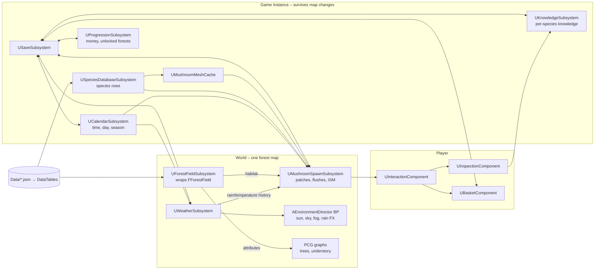

# Architecture

Status: **accepted at M0 review (2026-11-11)** — living document.
Goal: a playable slice quickly, with seams that let the project grow
(more forests, species, systems) without an over-engineered start.

## 1. Guiding principles

1. **Deterministic core, persistent deltas.** Everything that can be computed
   from a seed is computed (terrain fields, paths, landmarks, mycelium patches,
   weather, mushroom shapes). The save file only stores what the player changed
   (picks, inventory, knowledge, money…) and what cannot be recomputed.
2. **Pure C++ logic, thin UObject wrappers.** Models are plain structs/functions
   (`F…`) → unit-testable, reusable from editor tools, PCG nodes and runtime.
3. **Data outside code.** Species, forests, shop items, climates live in JSON
   (`Data/`) imported into DataTables/DataAssets; tunables in `UDeveloperSettings`.
4. **C++ owns behaviour, Blueprint owns presentation.** Base classes are
   `Blueprintable`; the developer sets meshes, materials, sounds, widget layouts.
5. **No per-actor tick for systems.** Subsystems tick and push updates.

> **UE concept — Subsystems.** A subsystem is an engine-managed singleton whose
> lifetime is tied to an owner: `UGameInstanceSubsystem` lives for the whole
> game session (survives map changes), `UWorldSubsystem` lives with one loaded
> level. No manual spawning, accessible from C++ and Blueprint.

## 2. Modules

| Module | Type | Content | When |
|---|---|---|---|
| `ShroomHunt` | Runtime | all gameplay code, organized by domain folders | now |
| `ShroomHuntEditor` | Editor | custom editor commands, asset creation that Python cannot do, detail customizations | only when needed (≥ M1d) |

One runtime module is enough for a solo project; domain folders keep it
organized and can be split into modules later if compile times grow.

Engine plugins to enable progressively: **PCG**, **PCG Geometry Script Interop**
(optional), **Geometry Scripting** (helpers), **Python Editor Script Plugin**,
**Editor Scripting Utilities**. Code depends on runtime modules
`GeometryCore` + `MeshConversion` (procedural meshes) and `PCG` (custom nodes).

## 3. Domain map

## 4. Classes per domain (`Source/ShroomHunt/<Domain>/`)

### Core
- `ShroomLog.h` — log categories.
- `ShroomHash.h` — deterministic hashing (`Hash(seed, a, b, …) → uint32`,
  `HashToUnitFloat`), 1D/2D value & gradient noise, fBm. Used by every generator.
- `AShroomHuntGameMode`, `AShroomHuntCharacter`, `AShroomHuntPlayerController`
  — from the template, extended.
- `UShroomCheatManager` — debug console commands (see §8).

### Time
- `UTimeSettings : UDeveloperSettings` — `DayLengthSeconds = 600`,
  `SeasonLengthDays = {Spring 6, Summer 5, Autumn 8, Winter 5}`,
  `BiologicalDaysPerGameDay = 4`, start date, latitude (sun path).
- `UCalendarSubsystem : UGameInstanceSubsystem, FTickableGameObject` — stores
  only `TotalGameSeconds` (double) and `TimeScale`. Derives `FGameDate`
  (year, season, day in season, day of year, time of day, real-calendar
  equivalent month). Broadcasts `OnHourChanged`, `OnNewDay`, `OnSeasonChanged`.
  Pauses outside forest maps (menus).

### Weather
- `FClimateProfile` — per-forest monthly means (temperature, rain frequency,
  fog propensity, storm propensity, diurnal amplitude). Comes from forest data.
- `FWeatherModel` (pure) — `Sample(Seed, Climate, GameTime) → FWeatherSample`
  {cloud cover, precipitation mm/h, fog density, wind, temperature, humidity,
  lightning}. **Random access in time**: built from seeded 1D noise over time
  (synoptic "pressure systems" at ~2-day scale + showers at ~1-hour scale)
  layered on the seasonal climate. No simulation state ⇒ the rain history of
  any period is recomputed on demand, also for forests the player is not in.
- `UWeatherSubsystem : UTickableWorldSubsystem` — current sample, discrete
  `EWeatherState` (Clear, PartlyCloudy, Overcast, Fog, Drizzle, Rain,
  HeavyRain, Storm) with hysteresis, `GetRainfall(From, To)`,
  `GetMeanTemperature(From, To)` (hourly cache), debug overrides
  (`ForceWeather(State, DurationHours)`, stored and saved).
- `AEnvironmentDirector` (`Environment/`, Blueprintable actor placed in each forest map) —
  drives Directional Light (sun & moon), Sky Atmosphere, Volumetric Clouds,
  Exponential Height Fog, Sky Light, rain Niagara, wetness material params
  (`MPC_Environment`). C++ computes targets, BP events allow art tweaks.

### Forest
- `UForestDefinition : UPrimaryDataAsset` (generated from `Data/Forests/*.json`)
  — id, display name, seed, size, map, climate, field parameters, tree species
  palette, base location, unlock requirements.
- `FForestField` (pure) — `Sample(X, Y) → FForestSample` {altitude, slope,
  aspect, moisture (topographic wetness), pH, soil type, stand composition
  (weights per tree genus), canopy cover, dead-wood density, parcel id, stand
  age class, distance to path/water}. Some layers are rasterized once at load
  (hydrology, distances) into `FFieldRaster` grids (4 m cells → 250×250 floats
  per layer for 1 km², ≈ 250 KB each).
- `FForestLayout` (JSON-serializable) — parcels, path graph (nodes, edges,
  rank, polylines), streams, landmarks. Output of the generator, committed in
  `Data/Forests/<Id>.layout.json` for review and reproducibility.
- `UForestGenerationLibrary : UBlueprintFunctionLibrary` — editor-callable
  entry points (from Python): `GenerateLayout`, `BakeHeightmap` (16-bit PNG),
  `BakeWeightmaps`, `ExportDebugMaps`.
- `UPCGForestFieldSettings` — **custom PCG node** writing field attributes
  (`Moisture`, `pH`, `Beech`, `Oak`, `Canopy`, `AgeClass`…) onto PCG points so
  graphs built in the editor can filter/select by them.
- `AForestPathNetwork` — spline components built from the layout (PCG reads
  them to clear vegetation and place path dressing).
- `ALandmark` (Blueprintable) — base class for landmark actors; a
  `ULandmarkCatalog` DataAsset maps landmark types to BP classes.

### Mycology
- `FMushroomSpeciesRow : FTableRowBase` — see `Docs/SpeciesData.md`.
- `USpeciesDatabaseSubsystem` — loads `DT_Species`, lookups by id/genus/group.
- `FSuitabilityModel` (pure) — static suitability per species and point.
- `FMyceliumPatch` — persistent "good spot": species, position, radius,
  strength, cluster pattern, phase. Generated deterministically per forest.
- `FFlushModel` (pure) — daily flush probability from lagged weather.
- `UMushroomSpawnSubsystem : UTickableWorldSubsystem` — builds patches at load
  (spatial hash, 32 m cells), runs the **daily growth tick** (and catch-up for
  missed days when returning to a forest), holds fruit-body states, streams
  visible fruit bodies into ISM components around the player (radius ≈ 80 m),
  promotes the focused one to an `AMushroomSpecimen` actor.

### Mushroom (morphology & mesh)
- `FMushroomMorphology` — one individual: cap profile/diameter/margin/surface/
  colors, underside type/color, stem length/thickness/shape, ring, volva,
  reticulation, stage, damage. Drawn from species ranges with a seed.
- `FMushroomMeshBuilder` (pure) — morphology → `FDynamicMesh3`: cap and stem
  are **surfaces of revolution** of 2D profile curves, then deformed (noise,
  asymmetry, tilt, margin waviness), with vertex colors and UVs; gills/pores
  via underside material (normal + mask) rather than geometry.
- `UMushroomMeshCache : UGameInstanceSubsystem` — `(species, stage, variant)
  → UStaticMesh` (2 LODs) via `FDynamicMesh3 → FMeshDescription →
  UStaticMesh::BuildFromMeshDescriptions`. ~8 variants × 3 stages per species.
- `AMushroomSpecimen` — interactable actor for the focused/picked individual,
  with a **unique** mesh generated from its exact morphology.

**Why this approach** (vs ProceduralMeshComponent or Geometry Script only):
`ProceduralMeshComponent` has no instancing, no LODs and no Nanite; it would
cost one draw call per mushroom. Geometry Script is a Blueprint-friendly layer
over the same `GeometryCore` library; calling `FDynamicMesh3` directly from C++
is simpler for a generator, testable, and runtime-safe. Converting to
`UStaticMesh` lets us use **ISM** (one draw call per mesh variant), LODs and
cull distances, while variant pooling + per-instance custom data (color tint,
scale) keeps memory tiny (≈ 3 species × 24 meshes × ~30 KB).

### Player / interaction
- `IInteractable` — `CanInteract`, `GetPrompt`, `Interact`.
- `UInteractionComponent` — camera trace (2.5 m), focus highlight, prompts.
- `UInspectionComponent` — examine mode: specimen in front of camera, rotate
  with mouse, reveals observable criteria; actions *Pick*, *Smell*, *Cut*
  (later: tests with kits).
- `UBasketComponent` — list of `FSpecimen` {species id, individual seed,
  stage, weight, picked time, condition flags (dirty, wormy, damaged),
  player label, verified flag}. Freshness decays with time.

### Knowledge & encyclopedia
- `UKnowledgeSubsystem` — per species: `Unknown → Observed → Identified →
  Mastered`, observation counters, unlocked sources (poster, books, kits).
- `FObservableCriteria` — what the player can see of a specimen given its
  knowledge level; builds vague designations ("Bolete?", "White-gilled
  mushroom").
- UI: `UEncyclopediaWidgetBase`, `UInspectionWidgetBase` (C++ bases with
  `BindWidget`), WBP subclasses for layout.

### Economy / progression (M3)
- `UProgressionSubsystem` — money, owned books/kits, unlocked forests, quests.
- `DT_ShopItems` (books per group, test kits, lab analysis, permits).
- `ABaseStation` actors (storage chest, sell counter, encyclopedia desk,
  later cleaning table/kitchen).

### Save
- `UShroomSaveGame : USaveGame` with `SaveVersion` and per-domain structs.
- `ISaveParticipant` — each subsystem writes/reads its own struct.
- Saved: calendar time, current forest + player transform, weather overrides,
  per-forest spawn state (patch exhaustion, live fruit bodies, picked ids),
  basket/storage, knowledge, money, items, unlocked forests.
  **Not saved** (recomputed): terrain fields, patches, weather, shapes.

## 5. Key runtime flows

**Frame:** Calendar advances → Weather samples (visual targets interpolated
every frame, gameplay state updated at ~1 Hz) → Environment director applies.

**Every 0.5 s:** Spawn subsystem updates visible fruit bodies around the player
(add/remove ISM instances from the spatial hash).

**New day (04:00 game time):** Spawn subsystem runs the growth tick: ages fruit
bodies (young → mature → old → gone), rolls flushes per patch from lagged
weather, decays patch exhaustion.

**Look at a mushroom:** trace hits ISM instance → spawn `AMushroomSpecimen`
with unique mesh at that transform, hide instance → *Examine* → criteria panel →
*Pick* → `FSpecimen` into basket, fruit body marked picked, patch exhaustion ↑,
knowledge observation recorded.

## 6. Extension points (planned, not implemented)
- **Cleaning / cooking / tasting**: `FSpecimen` already carries condition and
  freshness; future `UProcessingStation` actors at the base consume specimens
  and produce items via a `DT_Recipes` table.
- **Paper map / compass**: forest layout already contains parcels, named
  crossroads and landmarks → a map item can render from it.
- **More forests**: one `Data/Forests/<Id>.json` + one map + PCG graphs
  reusing the shared node set.

## 7. Threading & performance notes
- Patch generation and layout generation are pure → can run on a worker thread
  (`UE::Tasks`) during map load later; synchronous first.
- Mushrooms: ISM per (species, stage, variant), cull distance 60–80 m, no
  shadows on LOD1, no collision on ISM (traces use a cheap query channel on
  the spatial hash instead, or simple sphere collision on promoted actors).

## 8. Debug toolkit (M1)
Console commands (dotted names are registered through `IConsoleManager`
console commands; `UShroomCheatManager` holds the gameplay-side handlers):
- `sh.Time.Scale <x>`, `sh.Time.Set <hour>`, `sh.Time.SkipDays <n>`
- `sh.Weather.Force <State> <hours>`, `sh.Weather.Clear`
- `sh.Debug.Map <Layer|SpeciesId> [suitability|probability]` — overlays a
  rendered texture on the terrain (decal) and on a minimap widget.
- `sh.Debug.Patches <on|off>`, `sh.Spawn.FlushNow <SpeciesId>`
- `sh.Knowledge.UnlockAll`
- On-screen HUD: date, season, weather variables, rain over last N days.
