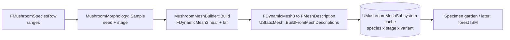

# M1c — Procedural mushrooms

Goal: every mushroom is generated from its species data and a seed — cap shape,
margin, colors, gills/pores/ridges, stem shape, ring, volva, warts — at three
growth stages, with a near and a far LOD, cached as static meshes.


*Fly agaric, cep and chanterelle at Young / Mature / Old (seed 3), rendered
with `Tools/Python/render_mushroom_preview.py`.*

## How it works



| Piece | Role |
|---|---|
| `FMushroomMorphology` | one individual: sizes, cap shape, colors, gill count, stem shape, ring, volva, warts, tilt, bend |
| `MushroomMeshBuilder` | pure geometry: revolved profiles (cap, stem, ring, sac volva), gill/ridge fins, wart and scale pyramids |
| `UMushroomMeshSubsystem` | engine subsystem: builds `UStaticMesh` at runtime (2 LODs, box collision) and caches variants |
| `UMushroomMeshSettings` | *Project Settings > ShroomHunt > Mushroom Meshes*: material, variants per stage, far-LOD switch |
| `AMushroomGarden` | debug actor laying out species x stages in a grid, in the editor and in game |
| `sh.Mesh.*` | `Stats`, `ClearCache`, `ExportObj` |

> **UE concept — Dynamic Mesh / Geometry Core.** `FDynamicMesh3` is UE's
> editable triangle mesh used by the modeling tools. We build it in C++,
> compute normals and tangents, then convert it to the `FMeshDescription`
> format and build a regular `UStaticMesh` at runtime. Static meshes support
> instancing (one draw call for many copies), LODs and collision — unlike
> `ProceduralMeshComponent` (D-008).

> **UE concept — LOD (level of detail).** Each mushroom has a *near* mesh
> (~2k triangles for a cep, ~5.5k for a fly agaric with its gills and warts)
> and a *far* mesh (~350–700 triangles, no gills). UE switches automatically when the mesh covers less than
> `FarLodScreenSize` of the screen.

Vertex colors carry the albedo (no textures needed); UV channel 1 stores a
surface id (cap top, underside, gills, stem, ring, volva, warts) so the
material can treat each part differently later.

## Editor steps

### 1. Create the mushroom material
Without it the meshes use the engine's flat debug vertex-color material.
1. Content Browser: create the folder `Content/ShroomHunt/Mushrooms`
   (right-click `ShroomHunt` > *New Folder*).
2. In it: right-click > **Material**, name it `M_Mushroom`, double-click it.
3. In the graph (empty area): right-click, type `Vertex Color`, select the
   **Vertex Color** node. Drag its white **RGB** output pin onto **Base Color**
   of the big *M_Mushroom* node.
4. Hold the `1` key and left-click in the graph: a constant node appears.
   In *Details* set its **Value** to `0.55`, then drag its output onto
   **Roughness**.
5. Toolbar **Apply**, then **Save**. Close the material editor.
6. *Edit > Project Settings > ShroomHunt > Mushroom Meshes*: **Mushroom
   Material** should already point to `M_Mushroom` (default path).

> Vertex colors are converted from sRGB to linear when the mesh is built, so
> the *Vertex Color* node can go straight into *Base Color*.

### 2. Place the specimen garden
1. Open `Lvl_FirstPerson`.
2. Toolbar **Quick Add** (cube with green +), type `Mushroom` in its search
   box, click **Mushroom Specimen Garden**. Move it on the floor near the
   player start (move gizmo `W`, the garden grows along +X and +Y).
3. The garden builds immediately in the viewport: one row per species, columns
   *Young / Mature / Old*. Labels face the -X direction.
4. *Details > ShroomHunt | Garden*:
   - **Individuals Per Stage**: 4 (try 8).
   - **Unique Individuals**: checked = every cell is a different individual
     (change **Seed Offset** to browse others); unchecked = the cached variants
     the forest will use (`Variants Per Stage` in the settings).
   - **Species**: leave empty for all, or add ids such as `AmanitaMuscaria`.
   - **Regenerate** button: rebuilds after re-importing species data.
5. *File > Save All*. Press **Play** and walk around the garden.

### 3. Edit a species and see the result
1. In `Data/Species/CantharellusCibarius.json`, change `"Colors": ["#F6D36B", "#E5A93A"]`
   in `Cap` to `["#F6D36B", "#C9781F"]` (more orange), save.
2. Run `Tools/Python/import_data.py` (*Tools > Execute Python Script…*).
3. Select the garden, click **Regenerate**: the chanterelles are more orange.
4. Revert the change, re-import, Regenerate.

### 4. Review shapes without the editor (optional)
```powershell
& "C:\Program Files\Epic Games\UE_5.8\Engine\Binaries\Win64\UnrealEditor-Cmd.exe" "$PWD\ShroomHunt.uproject" "-ExecCmds=sh.Mesh.ExportObj 3,QUIT_EDITOR" -unattended -nullrhi
python Tools/Python/render_mushroom_preview.py Saved/MushroomDebug Saved/MushroomDebug/preview.png
```
The OBJ files also open in Blender or the Windows *3D Viewer*.

## Test checklist
- [ ] `M_Mushroom` exists; the garden shows lit, colored mushrooms.
- [ ] Fly agaric: red cap with white warts, white gills, skirt ring, scaly
      volva. Cep: brown bun cap, pale pores (olive when old), fat club stem.
      Chanterelle: yellow funnel with forked ridges running down the stem.
- [ ] Young < Mature < Old in size; old caps flatter (fly agaric) or funnel-shaped (chanterelle).
- [ ] Walking away, meshes switch to the far LOD without popping too much
      (`r.ForceLOD 1` in the console forces it, `r.ForceLOD -1` resets).
- [ ] `sh.Mesh.Stats` (in PIE) shows the cached mesh count.
- [ ] Automation: 13 tests green (`ShroomHunt.Mushroom.*` included).

## UE concepts learned
- **GeometryCore** (`FDynamicMesh3`, attribute overlays for UVs, colors,
  normals, tangents) and **MeshDescription**.
- **Runtime static meshes** (`BuildFromMeshDescriptions`, material slots
  matched by name, LOD screen sizes).
- **Engine subsystems** (alive in the editor and in game) vs game-instance subsystems.
- **Construction-script components** (`OnConstruction`, `CreationMethod =
  UserConstructionScript`): rebuilt whenever the actor changes in the editor.
- **CallInEditor** functions: buttons in the Details panel.
- **Vertex colors** and **sRGB vs linear** color spaces.
