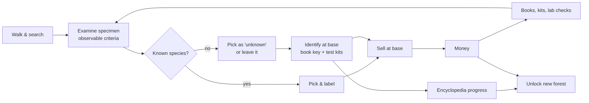

# Progression loop: identification, money, books, kits, forests

Status: **proposal (M0)** — options marked ⚖️ need a decision.

## 1. Core loop

## 2. Knowledge levels per species

| Level | How to reach | What the player sees |
|---|---|---|
| **Unknown** | default | nothing in encyclopedia; specimens show only visible criteria + vague label ("Bolete?", "White-gilled mushroom", "Small yellow funnel") |
| **Observed** | examined at least once | encyclopedia slot with silhouette + recorded criteria, habitat and date of each find |
| **Identified** | own the source (poster, book page, book) **and** correctly key out one specimen | real name on specimens of this species; full page: habitat, season, edibility, lookalikes |
| **Mastered** | N correct identifications (e.g. 10) | quality grading (freshness, worms) visible at a glance; warning when a lookalike is in the basket |

Identification is **active**: the book provides a short dichotomous key for
its group (e.g. Boletes: *pore color? stem network color? flesh turns blue?
taste?*). The player answers from what they observe in examine mode; some
answers need a **test**.

## 3. Sources of knowledge

- **Start**: the base's **poster** "Mushrooms of our woods" teaches
  **Chanterelle** and **Fly agaric** (one prized edible, one unmistakable
  toxic: a good first lesson).
- **Torn guide page** found at a landmark (hunting hut in M1) teaches the
  **Cep** — rewards exploration before the shop exists.
- **Books** (shop, M3), one per guide group, priced by difficulty/value:
  *Boletes* 40 €, *Chanterelles & allies* 30 €, *Amanitas* 60 €
  (dangerous group, essential), *Russulas & Lactarius* 50 €, *Morels &
  spring species* 45 €, *Wood-rotting fungi* 35 €… Each book contains the
  group's key and its species pages (pages stay "Observed" until you find one).
- **Test kits** (consumables, used in examine mode or at the base):
  - *Cut & wait* (free): flesh color change (bluing boletes).
  - *Spore print kit* (2 € / 5 uses, result after 1 game hour): spore color.
  - *Reagent kit* (KOH, iron salts, 6 € / 5 uses): color reactions for some groups.
  - *Taste test* (free, risky): bitter/acrid; forbidden for Amanitas — doing
    it on a deadly species triggers the poisoning consequences.
  - *Pharmacist check* (service at the village, 5 €, takes half a day): a
    definitive answer — in France pharmacists traditionally check foragers'
    harvests.

## 4. Money

- Selling at the base to a **collector/restaurant buyer**: price =
  `PricePerKg × weight × quality`, quality from stage (young/mature best),
  freshness (decays per game hour after picking) and condition (wormy,
  damaged, dirty → later cleaning raises it).
- Only **labelled** specimens can be sold; unknown ones can be stored, keyed
  out or discarded.
- Daily demand cap per species (prices drop if you flood the market) to
  encourage variety.
- Rough targets: a good autumn day at the start ≈ 30–60 €; the *Boletes* book
  is one good day; forest 2 needs a few in-game weeks.

## 5. Unlocking forests

Each forest requires **knowledge** *and* **money**:

| Forest | Requirement | Price (cabin rent / travel) |
|---|---|---|
| 1. Lowland oak–beech | start | — |
| 2. Mountain beech–fir (Vosges/Jura) | 8 species identified | 300 € |
| 3. Atlantic pine on sand (Landes) | 15 identified | 600 € |
| 4. Chestnut (Cévennes/Ardèche) | 22 identified | 900 € |
| 5. Mediterranean (Aleppo pine, holm oak) | 30 identified | 1 300 € |
| 6. Subalpine spruce–larch | 40 identified + 1 "society" quest | 2 000 € |

A letter from the regional **mycological society** announces each new forest
(light quest framing, no NPC needed). Knowledge gating ensures the player
learns; money gating keeps the selling loop meaningful.

## 6. ⚖️ Consequences of an error — options to choose from

| Option | Selling a toxic specimen | Eating a toxic specimen (later, with cooking) |
|---|---|---|
| **A. Soft / educational** | Buyer refuses it, small reputation loss, encyclopedia opens the confusion page | Sick for 1 game day (blurred vision, slow walk), money for medicine |
| **B. Reputation economy** | Reputation drives prices; a toxic sale = fine + reputation crash + buyer bans you for a few days; deadly = police report, big fine | Same as A, worse for deadly ones |
| **C. Realistic latency** | As B | Symptoms follow real latency (e.g. phalloidian: nothing for 6–12 game hours, then hospital, 3–5 days lost, large bill, basket lost) |
| **D. Hardcore (optional mode)** | As B | Deadly species can end the save (permadeath toggle in settings) |

Recommendation: **B for selling + C for eating**, with **D as an opt-in
difficulty setting**. It keeps the contemplative tone (no game over by
default) while making confusions genuinely scary, which is the educational
point of the game.

## 7. Extension points
- Cleaning table (raises quality), kitchen/tasting (consumption,
  consequences), drying (preserve), village market day with better prices.
