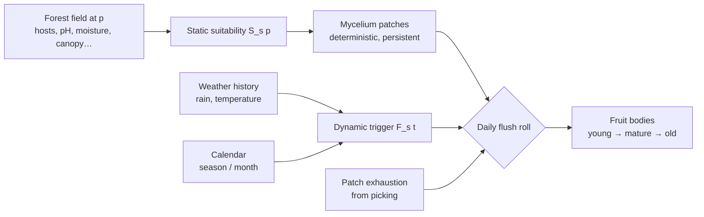

# Mushroom spawn model

Status: **accepted at M0 review (2026-11-11)** — living document.

Two layers, as in real life: **mycelium lives in persistent good spots**
(static), and **fruiting bodies appear when weather and season allow**
(dynamic).



## 1. Time conversions

| Quantity | Default | Meaning |
|---|---|---|
| `DayLengthSeconds` | 600 s | one game day = 10 real minutes |
| Season lengths | Spring 6, Summer 5, **Autumn 8**, Winter 5 game days | year = 24 game days = 4 h of play |
| `BiologicalDaysPerGameDay` `B` | 4 | biological processes run as if 1 game day = 4 real days |

- **Phenology** (which months a species fruits) uses the *calendar mapping*:
  each game season is mapped piecewise-linearly onto its real 3-month span
  (spring ⇒ 21 Mar – 20 Jun, …), giving a continuous `Month(t) ∈ [1, 13)`.
- **Biology** (rain window, lag, lifetime, cooldown) uses `B`:
  `days_game = days_real / B`. Calendar compression (~15 real days per game
  day) would make mushrooms pop up a few minutes after rain; `B = 4` keeps a
  readable cause → effect: rain today, mushrooms in 2–3 game days.
- **Rain amounts**: weather produces literal mm in game time. Over a
  compressed window, each game-mm stands for `B` real mm:
  `R_eq = B · Σ rain(window)`.

## 2. Static suitability `S_s(p) ∈ [0, 1]`

For species `s` at point `p`:

```
S_s(p) = H_s(p) · T(pH) · T(alt) · T(moisture) · T(canopy) · Soil_s(p) · Edge_s(p) · N_s(p)
```

- `T(x)` — trapezoid response from the species data (0 outside, 1 in optimum).
- `H_s(p)` — **host factor**:
  - mycorrhizal/parasitic: `H = clamp(Σ_g w_g(p) · a_{s,g}, 0, 1)` where
    `w_g(p)` is the stand fraction of tree genus `g` (from the forest field,
    the same field PCG uses to place trees) and `a_{s,g}` the species affinity;
  - saprotrophic: `H = substrate density` (dead wood, litter, stumps);
  - grassland: `H = 1 − canopy` on grass soil.
- `Soil_s(p)` — weight of the soil type at `p`.
- `Edge_s(p) = 1 + e_s · (edgeness(p) − 0.5)`, clamped to [0, 1.5], where
  `edgeness` ∈ [0,1] grows near clearings/edges.
- `N_s(p) ∈ [0.6, 1.2]` — low-frequency noise per species: real mycelia are
  patchy even in uniform habitat; it also makes "secret spots" emerge.

Final value clamped to [0, 1]. Debug map `sh.Debug.Map BoletusEdulis suitability`.

## 3. Mycelium patches (persistent good spots)

Per forest and species, deterministically (seed = `Hash(ForestSeed, SpeciesId)`):

1. Poisson-disk candidates with density `PatchDensityPerHa`.
2. Keep candidate with probability `S^γ` (γ = 1.5 sharpens toward the best places).
3. Patch = {position, radius ∈ `PatchRadiusM`, strength `S`, clustering
   pattern, phase noise, id}.

Patches are recomputed at each load (cheap, a few ms) and never saved; only
their mutable state (exhaustion, cooldown, live fruit bodies) is.
1 km² = 100 ha → cep: 150 candidates → ~50–70 patches.

## 4. Dynamic trigger `F_s(t) ∈ [0, 1]`

Evaluated at the daily growth tick (04:00) of game day `t`:

```
L  = LagDays_s / B          (lag, game days; random in [min,max] per patch & flush)
W  = RainWindowDays_s / B   (window length, game days)
R_eq = B · Rain(t − L − W, t − L)                    (mm)
Θ  = MeanTemp(t − L − W, t − L)                      (°C)

F_s(t) = Phen_s(Month(t)) · Rain_s(R_eq) · T_temp(Θ)
Rain_s(R) = smoothstep( (R − R_min) / (R_opt − R_min) )
```

So the weather that matters is the weather **one lag ago**: heavy rain on
day 10 produces a flush around day 12–13.

## 5. Daily flush roll per patch

```
P_flush = (1 − e^{−k_s · S · F_s(t)}) · (1 − E) · [not in cooldown]
N_fruits ~ Poisson(λ = FruitsPerFlush_s · S · F_s(t))
```

- `k_s` = `FlushRate` (species reactivity).
- `E ∈ [0, 1]` = **patch exhaustion**: each picked fruit body adds 0.15,
  decays exponentially with τ = 3 game days. Picking a spot clean ⇒ it will
  not refill right away (but a good spot recovers).
- Cooldown = `FlushCooldownDays / B` after each flush.
- Random draws use `Hash(ForestSeed, PatchId, Day)` ⇒ **same weather ⇒ same
  mushrooms**, no RNG state to save.
- Fruit bodies are placed inside the patch following the clustering pattern
  (fairy ring: on a circle with jitter; troop: Poisson inside the disc;
  caespitose: tight tufts of 3–8; solitary: one, rarely two), each with a
  birth offset of 0–0.5 day and an individual seed → shape.
- Stages: age / (`LifetimeDays / B`) < `StageSplit[0]` young, < `[1]` mature,
  else old; at 1.0 it disappears. Old ones may be wormy.

**Returning to a forest after N days**: replay the growth tick for the missed
days, but only the last `max lifetime` days matter ⇒ bounded cost.

## 6. Worked example — cep, mid-autumn

Settings: `B = 4`. Day `t` = autumn day 3 ⇒ `Month(t) ≈ 10.3` (mid October).

**Static suitability at the patch:**

| Factor | Value at p | Species range | Response |
|---|---|---|---|
| Stand | beech 0.55, oak 0.30, hornbeam 0.15 | affinities 1.0 / 1.0 / 0.3 | `H = 0.55 + 0.30 + 0.045 = 0.895` |
| pH | 5.2 | [3.8, 4.5, 6.0, 7.2] | 1.0 |
| Altitude | 180 m | [0, 0, 1600, 2100] | 1.0 |
| Moisture | 0.62 | [0.25, 0.40, 0.70, 0.85] | 1.0 |
| Canopy | 0.85 | [0.30, 0.50, 0.80, 0.95] | (0.95 − 0.85)/(0.95 − 0.80) = 0.667 |
| Soil | Loam | weight 1.0 | 1.0 |
| Edge | edgeness 0.5 | e = 0.2 | 1.0 |
| Noise | | | 1.0 |

`S = 0.895 × 0.667 ≈ 0.597` → patch kept with probability `0.597^1.5 ≈ 0.46`.

**Dynamic trigger:**
- Lag drawn 9 real days ⇒ `L = 2.25` game days; window 15 days ⇒ `W = 3.75`.
- Rain fell in game days [t − 6.0, t − 2.25]: 9 mm ⇒ `R_eq = 4 × 9 = 36 mm`.
  `Rain = smoothstep((36 − 20)/(40 − 20)) = smoothstep(0.8) = 0.896`.
- Mean temperature over the same window: 13 °C in [8, 12, 20, 24] ⇒ 1.0.
- Phenology: month 10.3 in [6, 8, 10.5, 11.8] ⇒ 1.0.
- `F = 1.0 × 0.896 × 1.0 = 0.896`.

**Roll:** `k = 1.2`, `E = 0` ⇒
`P_flush = 1 − e^{−1.2 × 0.597 × 0.896} = 1 − e^{−0.642} ≈ 0.47`.
If it flushes: `λ = 5 × 0.597 × 0.896 ≈ 2.7` ceps, each lives
`8 / 4 = 2` game days (young for 0.5 day, mature until 1.4 days).

Forest-wide, ~60 cep patches × 0.47 × 2.7 ≈ **75 ceps** that day if the whole
forest had this weather — to be tuned down in play-testing (patch density and
`k` are the knobs).

Same patch in a dry week (R_eq = 12 mm < 20) ⇒ `F = 0` ⇒ nothing, however
good the spot: the player learns *where* (static) and *when* (dynamic).

## 7. Debug views (M1)
- `suitability` map: `S_s(p)` as a heat map (decal over terrain + minimap).
- `probability` map: today's `P_flush` per patch (dots sized by λ).
- Patch gizmos: circles with id, strength, exhaustion, cooldown.
- HUD: `R_eq` and `F_s` per species for today.

## 8. Tests (automation)
- Trapezoid/smoothstep edge cases; suitability clamping.
- Determinism: same seed ⇒ identical patch list (hash of positions).
- Flush statistics: over 10 000 simulated days with constant inputs, mean
  flush frequency ≈ `P_flush` within tolerance.
