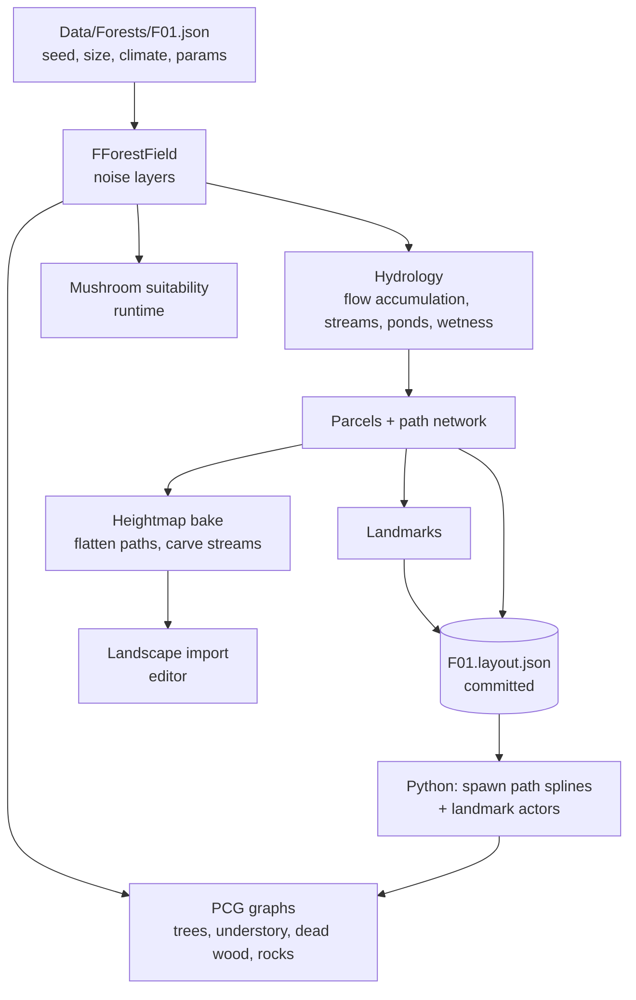

# World generation: forest field, paths, landmarks, PCG

Status: **proposal (M0)**.

## 1. Pipeline overview

Generation is **deterministic from `ForestDefinition.Seed`** and split into an
**editor bake** (things that shape the terrain or are few and hand-tweakable)
and **runtime / PCG** (massive scatter).

Starting size: **1 km² (1009 × 1009 landscape vertices, 1 m resolution)**,
growable to 2 km² / 4 km² later (2017² vertices) without changing the code.

> **UE concept — Landscape.** UE's heightfield terrain: a grid of vertices
> split into components with automatic LOD, paint layers (weightmaps) that
> drive the material (litter, moss, mud, gravel…), and grass output. A
> heightmap is imported as a 16-bit grayscale PNG/RAW.

## 2. Forest field layers

All layers are functions of (x, y) built from seeded noise (`ShroomHash.h`)
plus derived terrain analysis:

| Layer | Source | Use |
|---|---|---|
| Altitude | fBm + low ridges; relief 40–80 m for the lowland forest | terrain |
| Slope, aspect | gradient of altitude | south slopes drier/warmer |
| Flow accumulation | D8 flow on 4 m grid | streams (threshold), ponds (sinks) |
| Moisture | topographic wetness index `ln(a / tan β)` normalized, + distance to water | species, stands, fog |
| Soil type | low-freq noise thresholds + moisture (clay in lows, sand on rises) | species, pH |
| pH | soil base value + noise (acidic sand ~4.5, loam ~5.5, limestone ~7) | species |
| Parcels | Voronoi cells (~10–20 ha) clipped by roads | stand management |
| Stand per parcel | dominant mix + age class (regeneration, pole, mature high forest, clear-cut) | trees, canopy |
| Stand composition | per-genus weights = parcel mix × local tree suitability (beech: moist not waterlogged; oak: tolerant; hornbeam: understory; birch: clearings & acid; alder: streams) | PCG, host factor |
| Canopy cover | from age class + gaps noise | light, species |
| Dead wood | age class + noise | saprotrophs (later) |
| Edgeness | distance to clearings/roads/edge | edge species, fly agaric |

**Local biomes** for the oak–beech forest emerge from these layers:
pure beech on fresh slopes, oak–hornbeam on heavier soils, birch on acidic
rises and clearings, alder ripisylve along streams, sedge/wet meadow in
sinks, clear-cuts with brambles and young birches. Transitions are
continuous because every layer is.

**Parcels are the key to "learnable" forests**: as in French state forests,
each parcel has its own stand (age and species) and number, so the player
remembers "the old beeches of parcel 12".

## 3. Path network (hierarchical)

1. **Entrances & hubs.** 2–3 entrances on the map border (where roads would
   come from), the **base** (forester's house) near one entrance, and 3–6
   hubs placed by Poisson sampling on flat ground.
2. **Forest roads** (`Rank 0`, 4 m gravel): least-cost paths between
   entrances, base and hubs on a 4 m grid (A*), cost =
   `1 + 40·slope² + water penalty + noise`, then a minimum spanning tree plus
   one extra edge for a loop. Gradient capped ≈ 8 %.
3. **Rides / tracks** (`Rank 1`, 3 m dirt): **parcel boundaries**. French
   lowland state forests are crossed by long straight rides meeting at
   "star" crossroads (*carrefours en étoile*). Boundaries between Voronoi
   parcels are straightened into segments and kept when slope allows.
4. **Footpaths** (`Rank 2`, 1 m): A* with low slope weight and high noise
   (winding), connecting landmarks and scenic spots to the nearest track, plus
   a waymarked **loop trail** (a cycle in the graph through 2–4 landmarks,
   painted marks on trees every ~40 m).
5. **Post-process**: smoothing (Chaikin), merge nearby nodes into proper
   intersections, classify intersections (T, X, star), name them.

**Recognizable intersections**: every crossroads gets a *signature* chosen
from its context — signpost with a procedural French name
("Carrefour du Gros Chêne", "Rond de la Belle Épine"), calvary, log pile,
remarkable tree, parcel boundary stone with numbers.

Terrain integration: at bake time, paths flatten a corridor (road profile
with ditches for Rank 0) and paint `Gravel`/`Dirt` weightmap layers. Splines
(`AForestPathNetwork`) feed PCG to clear vegetation and place dressing
(puddles, ruts, grass strip in the middle of tracks).

## 4. Landmarks

Each type has candidate generation + a context score + spacing + a budget:

| Landmark | Candidate rule | Budget / km² |
|---|---|---|
| Forester's house (base) | near entrance, flat, on road | 1 |
| Hunting hut | on track, near clearing or clear-cut, flat | 1 |
| Hunting tower (*mirador*) | forest edge facing clearing/clear-cut, view cone open | 2–3 |
| Calvary | road/road or road/track crossroads | 1 |
| Ruin | near stream (old mill) or hilltop (chapel) | 0–1 |
| Pond | flow-accumulation sink with high moisture | 1–2 |
| Stream + bridge | stream from flow accumulation; bridge where a path crosses it | per crossing |
| Big rock | steep slope or ridge with rock noise | 2–4 |
| Remarkable tree | old oak/beech at crossroads or clearing, unique scale | 1–2 |
| Parcel stones & numbers | parcel corners on rides | per parcel |
| Log piles | along roads next to clear-cuts / mature parcels | 3–6 |

Greedy selection: sort candidates by score, accept if spacing constraints hold
(Poisson rejection), until budget. Output in `F01.layout.json`; a Python script
spawns actors from `ULandmarkCatalog` (type → BP class). Landmarks have a
`bLocked` flag so hand-tweaked ones survive regeneration.

## 5. PCG framework evaluation

> **UE concept — PCG (Procedural Content Generation).** A node-graph system
> (like material graphs, but for placing things): sample points on a surface
> or spline, compute attributes, filter, transform, and spawn meshes/actors.

What it brings to ShroomHunt:
- **Scatter at scale with instancing**: outputs to (H)ISM automatically —
  thousands of trees, bushes, logs with few draw calls.
- **Deterministic seeds** per component and node ⇒ fits our "same forest every
  time" rule.
- **Landscape and spline awareness**: sample the landscape, read its layers,
  exclude points near our path splines, place dressing along them.
- **Partitioned generation** aligned on a grid, and **runtime generation**
  around the player (generate/clean up cells by distance) ⇒ no millions of
  baked instances in the map files, low memory, no repo bloat.
- **Custom C++ nodes**: `UPCGForestFieldSettings` injects our field
  (stand composition, moisture, pH…) as point attributes so graphs stay
  consistent with the mushroom model.
- **Iteration in editor**: graphs re-run live when a parameter changes;
  the developer can tune density/variety visually without code.
- **Biome tooling**: UE 5.8 ships *PCG Biome Core* (experimental) — worth a
  test, but our own field + custom node is the safer core.

Limits / risks: runtime generation costs CPU on cell load (hitches if graphs
are heavy); experimental features change between versions; debugging large
graphs is visual-only. Mushrooms are **not** spawned by PCG: they change daily
and carry game state, so they use our own spawner.

Plan:
- **M1**: PCG graph `PCG_Forest_Trees` + `PCG_Forest_Understory`, partitioned,
  *Generate On Load* / editor generation for easier debugging.
- **M5** (bigger forests): switch heavy layers (understory, small debris) to
  **runtime generation** with a generation radius ~200 m, keep trees
  partitioned with HLOD.

## 6. World Partition & memory budget (16 GB RAM)

> **UE concept — World Partition.** The map is split into a grid of cells
> streamed in/out around the player; actors are saved one file each
> (`__ExternalActors__`). HLODs show cheap proxies for unloaded far cells.

Starting values (to measure, then tune):
- Runtime grid cell size **128 m**, loading range **384 m** (≈ 36 cells loaded
  out of 64 for 1 km² — the slice is small enough to hold almost entirely;
  the settings matter when the forest grows).
- Landscape: 1009 × 1009, 63 quads/section, 2×2 sections/component,
  8×8 components; streaming proxies per WP cell.
- Trees: Nanite meshes where available, ISM via PCG, cull distances by layer
  (small debris 60 m, bushes 150 m, trees: HLOD beyond loading range).
- Mushrooms: ISM, visible ≤ 80 m, a few hundred instances at most.
- Budget target in PIE: **< 9 GB process RAM** for the editor + game with
  the slice loaded, leaving room for Windows, VS and the browser.
- Use `stat memory`, `memreport -full` and Unreal Insights (`-trace=memory`)
  to check before each milestone.
