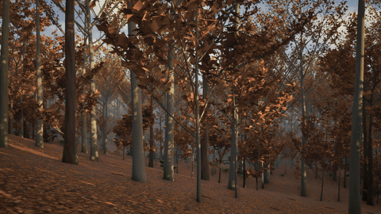

# ShroomHunt

*A contemplative first-person mushroom-foraging game in procedurally generated
French forests — Unreal Engine 5.8, C++.*

> **Status: pre-alpha.** The vertical slice is playable: a 1 km² procedural
> forest with time, weather, seasons, 13 mushroom species that grow from a
> mycological model, foraging, identification, a buyer's counter and saves.

[](Docs/Media/ShroomHunt_demo.mp4)

*Extracts of the demo reel. **[Watch the full video (3 min 30)](Docs/Media/ShroomHunt_demo.mp4)**: every
shot is placed by code from the forest data (the mushroom close-ups search the
days when the spawn model makes the species fruit) and rendered offline at a
fixed time step (`sh.Demo.Render`).*


*Everything on screen is generated from the data in `Data/`: trees, plants,
ground debris, mushrooms, buildings and ground textures. No downloaded asset.*


*The 13 species built from their species data, young / mature / old (offline
preview render): ceps and bitter boletes, chanterelles and their false
lookalike, fly agaric, death cap and panther cap, green brittlegill, wood
blewit, yellowfoot, St George's mushroom, morel and the deadly false morel.*


*The deterministic "forest field" of the first forest (1 km²): terrain with
streams and ponds, wetness, soils, pH, dominant tree genus per parcel, canopy.
It drives the terrain, the vegetation and where each mushroom species grows.*

## Pitch

Walk through vast French forests that change with the hour, the weather and
the seasons. Learn where and when mushrooms grow — after the rain, under the
right trees, on the right soil — and learn to tell a prized cep from a
bitter bolete, or a chanterelle from a toxic jack-o'-lantern. Sell your
harvest, buy field guides and test kits, fill your encyclopedia and unlock
new forests, from lowland oak woods to subalpine larches.

## Features

Done in the vertical slice:

- **Deterministic forest** from a seed and a JSON definition: terrain,
  hydrology, soils, pH, parcels and stands, a graded path network (roads,
  rides, footpaths), named crossroads with signposts, a forester's house, a
  hunting tower, ponds and streams.
- **Procedural vegetation**: trees grown from a branching skeleton per genus,
  shrubs, bracken and brambles, ground debris (single leaves, twigs, moss,
  stones) placed by a custom PCG node, baked to Nanite meshes at startup.
- **Mushroom spawning** from a mycological model: habitat suitability,
  persistent mycelium patches, flushes triggered by the rain of past days,
  growth from button to rot.
- **Procedural mushroom meshes**: gills, pores, ridges, warts, rings, volvas,
  pitted morel caps carved by 3D noise; one deterministic individual per seed.
- **Time, weather and seasons**: day/night, rain, fog, storms, snow cover
  and frost, leaf colors and leaf fall per genus; snow makes a hollow around
  the mushrooms instead of burying them.
- **Foraging and knowledge**: examine a specimen by its observable criteria,
  pick it, identify it with field guides found in the forest or bought at the
  counter, sell the basket (quality, freshness, toxic basket rule); saves.

Planned:

- **More forests** inspired by French regions (pine heath, mountain beech-fir,
  subalpine larch), unlocked as the player progresses.
- **Identification tools**: keys, spore prints and test kits; the pharmacist's
  check; an encyclopedia desk at the house.
- **More species**, including wood-growing ones, and more landmarks.

Debug tools: suitability and spawn maps, offline spawn simulation over years,
time acceleration, forced weather, season preview, on-screen HUD (`sh.*`
console commands).

## Architecture

C++ core with thin Blueprint subclasses for presentation; pure-C++
deterministic models (weather, forest field, spawn model, mesh builder)
wrapped by UE subsystems; gameplay data in JSON imported into DataTables;
UE5 PCG for vegetation scatter, World Partition streaming.

Design documents:
[Architecture](Docs/Architecture.md) ·
[Species data](Docs/SpeciesData.md) ·
[Spawn model](Docs/SpawnModel.md) ·
[World generation](Docs/WorldGeneration.md) ·
[Progression](Docs/Progression.md) ·
[Roadmap](Docs/Roadmap.md) ·
[Decision log](Docs/Decisions.md)

## Building

Requirements: Windows 10/11, Unreal Engine **5.8**, Visual Studio 2022 with
the "Game development with C++" workload (see `.vsconfig`), Git LFS.

```bash
git lfs install
git clone https://github.com/EtienneMarec/ShroomHunt.git
```

1. Right-click `ShroomHunt.uproject` → *Generate Visual Studio project files*.
2. Open `ShroomHunt.sln`, select *Development Editor | Win64*, build.
3. Open `ShroomHunt.uproject`.

No third-party asset is needed: trees, plants, mushrooms and ground debris
are generated from the data in `Data/` (D-039).

## License

Original code, data, tools and docs: [MIT](LICENSE). Files derived from
Unreal Engine templates and Unreal Engine content fall under the Unreal
Engine EULA; third-party assets are not included and keep their own licenses.
